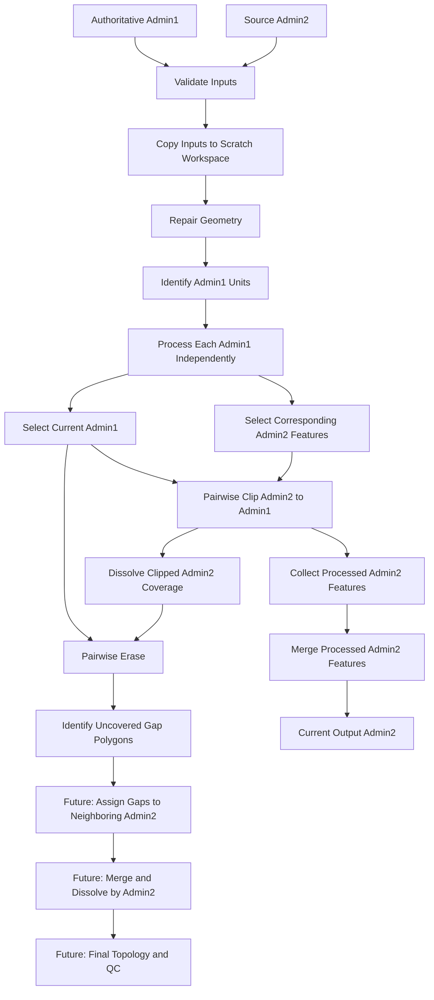

# Administrative Boundary Alignment

An ArcGIS Pro / ArcPy tool for aligning lower-level administrative boundaries to an authoritative higher-level administrative boundary.

The tool is designed for workflows where administrative levels come from different sources. For example, an authoritative **Admin1** boundary may come from a national census or statistical office, while **Admin2** boundaries may come from GADM or another secondary source. The objective is to preserve the internal Admin2 divisions while ensuring that their combined outer boundary conforms to the authoritative Admin1 geometry.

## Purpose

Administrative boundary datasets from different sources often do not align exactly. Differences may occur because of varying source scales, digitization methods, publication dates, coordinate precision, or generalization.

This tool provides a controlled workflow for reconciling those differences by treating the higher administrative level as authoritative.

The intended relationship is:

```text
Dissolved final Admin2 boundary ≈ Authoritative Admin1 boundary
```

while preserving the original internal Admin2 boundaries wherever possible.

## Methodological Principle

The workflow performs **hierarchical boundary conflation** rather than a simple buffer or expansion operation.

The authoritative Admin1 dataset defines the permitted exterior boundary. The Admin2 dataset provides the internal administrative partition. Geometry is modified only where necessary to reconcile the lower-level coverage with the authoritative higher-level boundary.

The workflow follows these principles:

1. Admin2 polygons must not extend beyond their corresponding authoritative Admin1.
2. Admin2 polygons should collectively cover the complete Admin1 area.
3. Internal Admin2 boundaries should remain unchanged wherever possible.
4. Admin2 polygons should not overlap one another after processing.
5. Geometry changes should be limited to areas required for boundary reconciliation.

## Current Processing Workflow

The current implementation performs the initial alignment and gap-detection stages.

For each Admin1 unit, the script:

1. Selects the authoritative Admin1 feature.
2. Selects all source Admin2 features assigned to that Admin1.
3. Clips the Admin2 features to the authoritative Admin1 boundary using `PairwiseClip`.
4. Dissolves the clipped Admin2 features to determine their combined coverage.
5. Uses `PairwiseErase` to identify portions of the authoritative Admin1 that are not covered by the clipped Admin2 polygons.
6. Combines the processed Admin2 features into the output dataset.

Automatic assignment of uncovered gap polygons to neighboring Admin2 units is planned as a subsequent processing stage.

## Workflow Diagram



GitHub supports Mermaid diagrams in Markdown in environments where Mermaid rendering is enabled. If the diagram is not rendered in the intended repository or documentation environment, it can be rendered separately and saved as an image. The Mermaid block above can then be replaced with, for example:

```markdown

```

## Input Requirements

### Authoritative Admin1 Features

A polygon feature class containing the higher-level administrative boundaries that will define the authoritative exterior geometry.

### Admin1 ID Field

A field uniquely identifying the Admin1 units used during processing.

### Source Admin2 Features

A polygon feature class containing the lower-level administrative units that will be aligned to the authoritative Admin1 boundaries.

### Admin2 Parent Admin1 Field

A field identifying the Admin1 to which each Admin2 belongs.

The Admin1 ID and Admin2 parent ID must already be compatible before running the tool. Crosswalking administrative names or identifiers is considered an input-data preparation step and is intentionally not performed by the tool.

For example:

| Admin1 ID | Admin1 Name | Admin2 Parent ID | Admin2 Name |
|---|---|---|---|
| A01 | Province A | A01 | District 1 |
| A01 | Province A | A01 | District 2 |
| A02 | Province B | A02 | District 3 |

## Coordinate System Requirements

Both input datasets should use the same coordinate system before processing.

For boundary comparison and area-based QC, a suitable projected coordinate system is preferable to a geographic coordinate system because later workflow stages may calculate areas, distances, or shared boundary lengths.

The tool currently checks whether the two input spatial references are compatible and stops processing if they differ.

## Project Structure

A simple project structure is recommended:

```text
boundary_alignment/
|
|-- BoundaryAlignment.pyt
|-- boundary_alignment.py
`-- README.md
```

The Python toolbox provides the ArcGIS Pro interface, while `boundary_alignment.py` contains the geoprocessing logic.

Keeping these components separate allows the processing module to be tested and maintained independently from the toolbox interface.

## Toolbox Parameters

The Python toolbox exposes the following parameters:

| Parameter | Direction | Description |
|---|---|---|
| Authoritative Admin1 Features | Input | Authoritative higher-level polygon boundaries |
| Admin1 ID Field | Input | Unique identifier for the Admin1 units |
| Source Admin2 Features | Input | Lower-level polygon boundaries to align |
| Admin2 Parent Admin1 Field | Input | Field linking each Admin2 to its parent Admin1 |
| Output Admin2 Features | Output | Processed Admin2 feature class |

## Geometry Protection

The source datasets are not modified directly.

Before processing, the tool creates working copies in the ArcGIS scratch geodatabase and performs `RepairGeometry` on those copies. This allows geometry corrections to occur without altering the original source data.

## Current Output

The current version produces an Admin2 feature class that has been clipped to the authoritative Admin1 boundaries.

This ensures that:

```text
Processed Admin2 ⊆ Authoritative Admin1
```

However, areas where the source Admin2 coverage falls short of the authoritative Admin1 boundary are currently identified as gaps but are not yet assigned to an Admin2 feature.

Therefore, the current output should be considered an intermediate alignment result until gap assignment and final topology validation are implemented.

## Planned Gap Assignment

A future processing stage will assign uncovered areas to neighboring Admin2 polygons.

The proposed approach is to evaluate the Admin2 polygons adjacent to each gap and assign the gap according to the strongest geometric relationship, with **shared boundary length** as the primary criterion.

Conceptually:

```text
Authoritative Admin1
        |
        +-- Existing Admin2 coverage
        |
        `-- Uncovered gap
                 |
                 +-- Neighbor Admin2 A
                 +-- Neighbor Admin2 B
                 `-- Neighbor Admin2 C
                         |
                         v
                 Compare shared boundaries
                         |
                         v
                 Assign best-supported neighbor
```

Ambiguous cases should be flagged for review rather than automatically forced into an Admin2 polygon.

## Planned Quality Control

The final workflow is expected to include geometry and change metrics such as:

- Original Admin2 area
- Final Admin2 area
- Area removed during clipping
- Area added during gap assignment
- Percent area change
- Number of gaps assigned
- Gap assignment confidence or status
- Topology validation status

Recommended final topology checks include:

### No Admin2 Outside Parent Admin1

```text
Admin2 - Parent Admin1 = 0
```

### No Gaps Within Admin1

```text
Admin1 - Dissolved Admin2 coverage = 0
```

### No Admin2 Overlaps

Lower-level administrative polygons should not overlap one another within the same parent Admin1.

### Admin2 Reconstructs Admin1

When Admin2 features are dissolved by their parent Admin1 identifier, the resulting geometry should match the authoritative Admin1 boundary within the applicable geoprocessing tolerance.

## ArcPy Operations

The workflow currently relies primarily on standard ArcPy geoprocessing operations, including:

```python
arcpy.management.CopyFeatures()
arcpy.management.RepairGeometry()
arcpy.management.MakeFeatureLayer()
arcpy.management.SelectLayerByAttribute()
arcpy.analysis.PairwiseClip()
arcpy.management.Dissolve()
arcpy.analysis.PairwiseErase()
arcpy.management.Merge()
```

Future versions may also use operations such as polygon-neighbor analysis, boundary intersection, spatial joins, or near-table generation to support gap assignment and QC.

## Limitations

The tool assumes that input administrative relationships have already been prepared correctly. It does not currently resolve differences in administrative names or identifiers between sources.

The tool also does not determine whether the Admin1 or Admin2 source is historically or administratively correct. The selected Admin1 input is explicitly treated as authoritative for the purpose of geometric alignment.

Large discrepancies between sources may represent genuine differences in administrative definitions rather than simple geometry misalignment. These cases should be reviewed before automatically modifying lower-level boundaries.

## Development Status

**Version 1 - In development**

Current functionality:

- [x] ArcGIS Python toolbox interface
- [x] Independent ArcPy processing module
- [x] Input validation
- [x] Working copies of source geometry
- [x] Geometry repair
- [x] Admin1-by-Admin1 processing
- [x] Admin2 clipping to authoritative Admin1
- [x] Detection of uncovered Admin1 areas
- [ ] Automatic gap assignment
- [ ] Ambiguous-gap identification
- [ ] Admin2 reconstruction after gap assignment
- [ ] Geometry-change metrics
- [ ] Final topology validation
- [ ] QC output layer/report

## Recommended Use

The tool is intended for controlled administrative-boundary harmonization workflows where:

- the authoritative higher-level geography is known;
- lower-level administrative units have already been associated with their correct parent unit; and
- preserving the lower-level internal subdivision is preferable to replacing the lower-level dataset entirely.

All resulting boundaries should undergo visual and topology-based QC before being treated as final authoritative outputs.
